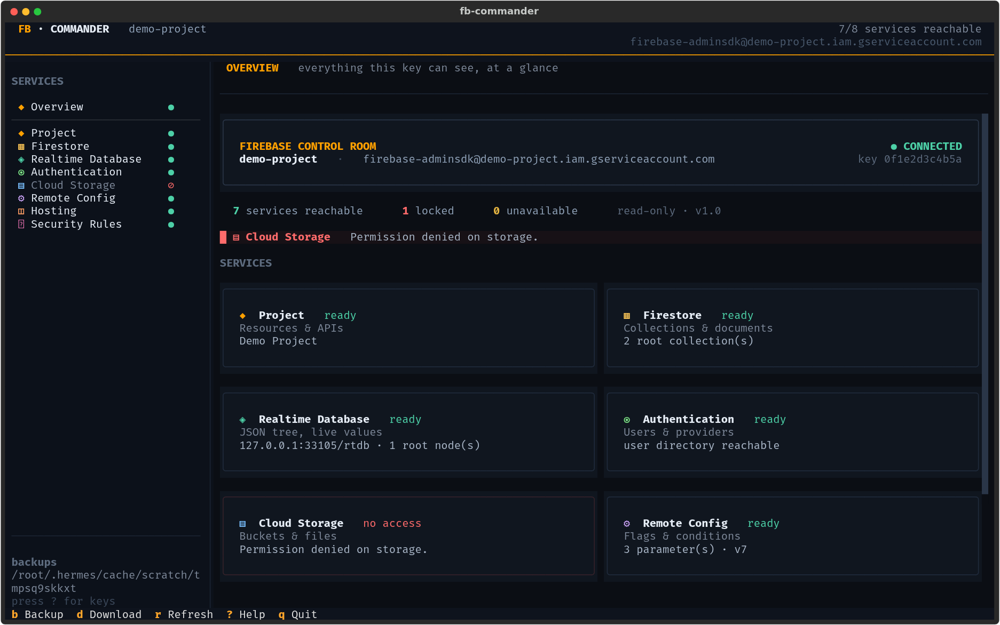
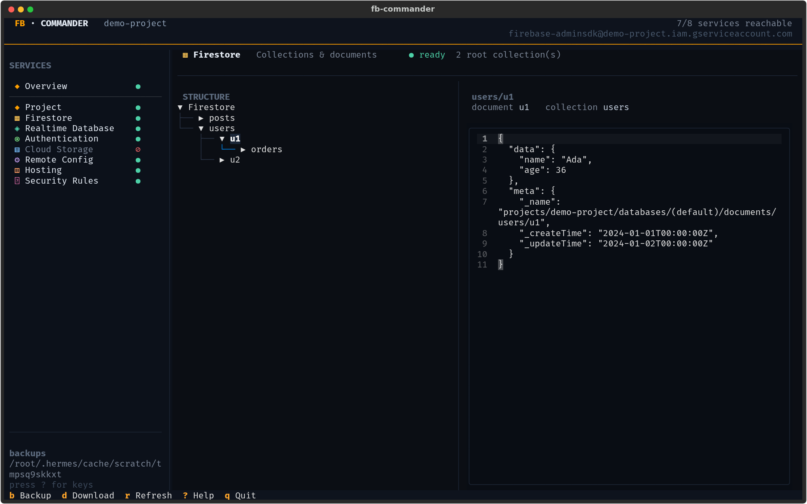
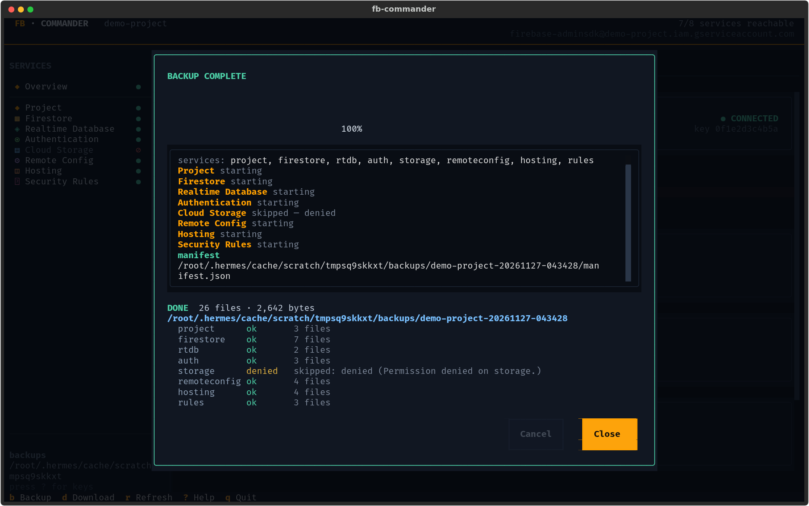
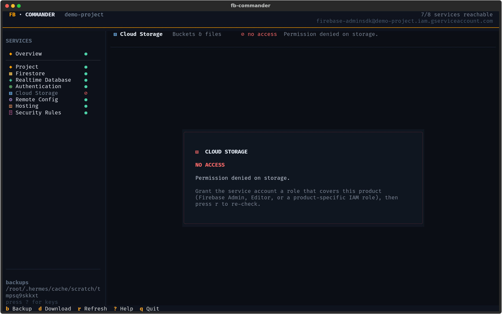

# fb-commander

A terminal control room for a Firebase project. Paste a service-account key, and the tool
probes every product, shows what that key can and cannot touch, lets you browse the data,
and writes the whole thing to a folder of plain files.

Read-only by design: it never writes, deletes or publishes anything back to your project.



## Install

```bash
./run.sh          # builds .venv on first run, then opens the TUI
```

or install it as a command:

```bash
python3 -m venv .venv && . .venv/bin/activate
pip install .
fb-commander
```

Requires Python 3.11+. Dependencies: Textual, google-auth, requests, cryptography.

## Use

1. Start it — it asks for a key.
2. Paste the **entire** service-account JSON (Ctrl+Shift+V / right-click paste) and press **F5**.
   Or tick *remember on this machine* to store it at `~/.config/fb-commander/credentials/<project>.json`
   with `0600` permissions; saved keys appear on the connect screen next time.
3. The dashboard appears once the probe finishes. Services the key cannot use are dimmed with a
   `⊘` and a reason instead of an empty screen.

| key | action |
|---|---|
| `↑ ↓` | move in the rail / tree / table |
| `→ ←` | expand / collapse a node |
| `Enter` | open a bucket, prefix, site or row |
| `Backspace` | up one level |
| `d` | download the highlighted node, document, object, user or ruleset |
| `b` | backup dialog: services, RTDB subtree, storage prefix, destination |
| `r` | re-probe access and reload |
| `/` | search users by email or uid (server-side) |
| `n` | next page |
| `?` | full key reference |
| `q` | quit |



## What it reads

| service | browsing | backup |
|---|---|---|
| Project | resources, registered apps, enabled APIs | `project/` |
| Firestore | collections → documents → subcollections, decoded values | one JSON per document, nested |
| Realtime Database | lazy JSON tree | whole database or one subtree |
| Authentication | paginated users, server-side email/uid lookup | `users.ndjson` + `users.json` |
| Cloud Storage | buckets → prefixes → objects, metadata + text snippet | byte-for-byte mirror |
| Remote Config | parameters, conditions, values | full config + per-parameter files |
| Hosting | sites, releases, channels | metadata only |
| Security Rules | live releases and their ruleset source | source files per ruleset |

Every product is probed with one cheap call at connect time. A `403` becomes a typed
*permission denied* state, a disabled API becomes *api disabled*, a 404 becomes *not initialised* —
none of them crash the app or abort a backup.

## Backups

`b` opens the options dialog; `./run.sh backup` runs the same thing headlessly.

```
~/firebase-backups/entres-potes-20261127-104500/
├── README.txt
├── manifest.json              what ran, what was skipped, counts, timings
├── project/                   project.json, apps.json, enabled_apis.json
├── firestore/users/u1.json    decoded document + _meta (name, create/update time)
├── firestore/users/u1/orders/…  subcollections nested under the document
├── rtdb/database.json         the full tree (or rtdb/subtree.json)
├── auth/users.ndjson          one user per line, plus users.json
├── storage/<bucket>/<path>    exact bytes, prefix filter respected
├── remoteconfig/              remote_config.json + parameters/<key>.json
├── hosting/<site>/            sites, releases, channels (no file contents)
└── rules/                     releases.json + rulesets + source files
```

Denied services are recorded in `manifest.json` as `"state": "denied"` with the API's message;
everything else still completes. A cancelled run stops between services.



## Selective downloads

`d` writes just the highlighted item under
`~/firebase-backups/downloads/<project>/<service>/…`:

- an RTDB node → one `.json` file (path preserved)
- a Firestore document or a whole collection/subtree → file or nested folder
- a Storage object → the object's bytes at its full key path
- a user, parameter, site or ruleset → one JSON file / folder

## CLI (no TUI)

```bash
./run.sh probe    --creds key.json                 # access map, then exit
./run.sh backup   --creds key.json -o ~/fb \
                  [--services firestore,rtdb,auth] \
                  [--rtdb-path /users] [--storage-prefix photos/] \
                  [--max-file-mb 200]
```

`backup` prints a JSON summary (`root`, `files`, `bytes`, `failed`, `skipped`) on stdout and
progress on stderr, so it drops straight into cron.

## Permissions

A service account key is limited by its IAM roles, not by anything this tool does. The probe
tells you exactly where the wall is; grant a role and press `r`.

- read everything → `roles/firebase.admin` (or `roles/editor`)
- narrower → `roles/datastore.viewer`, `roles/firebase.viewer`,
  `roles/firebaseauth.viewer`, `roles/storage.objectViewer`, `roles/cloudconfig.viewer`

Storage buckets often need a bucket-level IAM grant even when the project role is broad.



## Security

- Credentials go only to Google's APIs; there is no telemetry and no third-party endpoint.
- Saved keys are written with `0600` inside a `0700` directory, only when you tick the box.
- Download filenames are sanitised, and Storage keys are forced under the destination folder
  (no `../` escapes).
- The tool never sends write requests. Hosting file contents are not mirrored; Firestore and
  RTDB are exported as readable JSON rather than Google's binary export format.

## Development

```bash
.venv/bin/python tests/e2e_core.py   # engine: probe/tree/preview/backup/download, 52 checks
.venv/bin/python tests/e2e_cli.py    # CLI probe + backup + bad-key handling
.venv/bin/python tests/e2e_tui.py    # drives the real TUI, writes screenshots/
```

The suites run against `tests/mock_firebase.py`, an in-process REST fixture with a toggleable
permission wall, so no credentials or network are needed. `FB_CMD_*` environment variables
override every API root (that is how the fixture is wired in), and `FB_CMD_ACCESS_TOKEN`
skips token minting when you already hold one from `gcloud auth print-access-token`.

Sanity check while hacking on the UI:

```bash
fb-commander --creds key.json     # skips the paste screen
```
